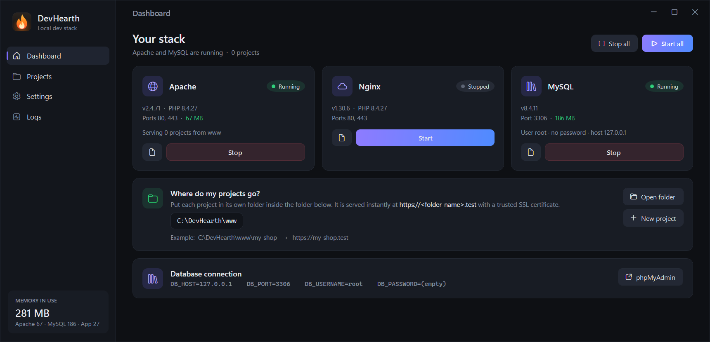

# DevHearth

**[⬇ Download DevHearth for Windows](https://github.com/vs-chauhan/devhearth/releases/latest)** · [Website](https://vs-chauhan.github.io/devhearth/)



A small, fast local development stack for Windows: **Apache or Nginx + PHP + MySQL**, with automatic
`https://<project>.test` domains. Inspired by Laragon/XAMPP, but kept minimal and light on memory.

- **One click** to start/stop Apache, Nginx and MySQL (only what you need)
- **Drop a folder in `C:\DevHearth\www`** and it is live at `https://<folder>.test` with a trusted SSL certificate
- **Low RAM**: the app is a ~190 KB exe (~30-50 MB RAM, less when hidden in the tray); MySQL is tuned to ~130 MB (vs ~400 MB with defaults)
- **PHP 8.2 / 8.3 / 8.4 / 8.5** switchable, Composer included, PHP SSL bundle set up (Shopify API calls just work)
- **Go apps**: any folder with a `go.mod` gets a Run button and is served at `https://<folder>.test` too
- **phpMyAdmin** at `https://phpmyadmin.test` (logs in as root automatically), with a one-click **Update** button
- **Reverse proxy** per project: point `myapp.test` at a Node/Remix/Shopify CLI dev server port
- Tray icon, start with Windows, logs viewer, "terminal here" with php/composer/mysql ready

## Install

1. Download `DevHearth-Setup-x.y.z.exe` from the [**latest release**](https://github.com/vs-chauhan/devhearth/releases/latest) and run it (no admin needed, installs to `C:\DevHearth`).
   If Windows shows **"Windows protected your PC"**, click **More info ▸ Run anyway** (see the note below).
2. Open DevHearth and click **Install components**. It downloads the official builds once (~345 MB):
   Apache (Apache Lounge), Nginx (nginx.org), PHP (windows.php.net), MySQL 8.4 LTS (mysql.com), Composer, phpMyAdmin.
3. Approve the two Windows prompts:
   - **Security warning: install certificate "DevHearth Local CA"**: makes `https://*.test` trusted in Chrome/Edge.
   - **UAC (admin)**: adds your `.test` domains to the hosts file. Asked again only when you add/remove projects.
4. Click **Start all** and open **https://hello.test**.

Requirements: Windows 10/11 64-bit. .NET Framework 4.8 is already part of Windows.
The Microsoft Visual C++ runtime is installed automatically if missing.

> **Why does Windows show a SmartScreen warning?** DevHearth is a new app from an independent developer, and
> its installer is not code-signed yet (signing certificates are a paid service). SmartScreen warns about every
> new unsigned download until enough people have installed it. The installer only writes to `C:\DevHearth`,
> asks for admin rights only to edit the hosts file, and changes nothing without your approval.

## Daily use

| You want to… | Do this |
|---|---|
| New project | Projects ▸ type a name ▸ **Create project**, or just create/clone a folder in `C:\DevHearth\www` |
| Open a site | `https://<folder>.test` (Laravel `public/` and Shopify PHP `web/public/` are detected automatically) |
| Database | host `127.0.0.1`, port `3306`, user `root`, empty password |
| Manage databases in the browser | Dashboard ▸ **phpMyAdmin** (or the tray menu) opens `https://phpmyadmin.test` |
| Update phpMyAdmin | Settings ▸ phpMyAdmin ▸ **Update phpMyAdmin** (checks phpmyadmin.net, downloads only if newer) |
| Use php/composer in any terminal | Settings ▸ **Add tools to PATH** (or the terminal button on a project) |
| Switch Apache ⇄ Nginx | Press Start on the other card (the running one stops automatically) |
| Switch PHP version | Settings ▸ PHP version chip (downloads it the first time) |
| Proxy to a dev server | Projects ▸ type a port (e.g. `3000`) in the project's **Proxy** box |
| New Go app | Projects ▸ choose **Go** ▸ **Create project**, then press **Run** |

### Go apps
A folder in `www` that contains a `go.mod` is treated as a Go app:

1. DevHearth gives it a fixed local port (4100, 4101, …, editable in the **Port** box).
2. **Run** builds it (`go build`, the main package in the root or `cmd/<name>`) into `tmp\go-bin\<name>.exe`
   and starts that binary with `PORT=<port>` (plus `DEVHEARTH_URL=https://<name>.test`).
   Running the binary directly keeps RAM low (~15 MB instead of ~80 MB+ with `go run`).
3. Apache/Nginx proxies `https://<name>.test` → `127.0.0.1:<port>` with the same trusted certificate,
   `X-Forwarded-Proto: https` and websocket support. If no web server is running, Run starts one.

Your app only has to read the port:
```go
port := os.Getenv("PORT")
http.ListenAndServe("127.0.0.1:"+port, mux)   // 127.0.0.1 = no Windows Firewall prompt
```
After editing code press **Stop** then **Run** to rebuild. Output goes to `logs\go-<name>.log` (the page icon).
Go itself is downloaded on first use (Settings ▸ Go) into `bin\go`; "Add tools to PATH" adds `go` too.

### Shopify development tips
- **Shopify PHP app (Laravel template)**: clone into `www\my-app`; DevHearth serves `web\public` at
  `https://my-app.test`. Set `DB_HOST=127.0.0.1`, `DB_USERNAME=root`, `DB_PASSWORD=` in `.env`.
- **Node/Remix apps or `shopify theme dev`**: run the CLI as usual, then set the project's **Proxy** port
  (e.g. 3000, or 9292 for theme dev) to reach it at `https://<name>.test` with HMR websockets working.
- Outgoing HTTPS from PHP (Admin API, webhooks) uses the bundled `cacert.pem`, so no cURL error 60.

## Folder layout

```
C:\DevHearth\
  DevHearth.exe        the app
  devhearth.ini        settings
  www\               YOUR PROJECTS  (www\shop  ->  https://shop.test)
  data\mysql\        your databases
  bin\               downloaded servers: apache, nginx, mysql, php\8.x, composer, go, phpmyadmin
  etc\               generated configs (apache, nginx, mysql) + ssl certificates
  logs\              apache_error.log, nginx_error.log, mysql_error.log, php_error.log, devhearth.log
  tmp\               temp files
```

Configs in `etc\` are regenerated on every start. To change PHP settings, edit `bin\php\<ver>\php.ini`.

## Troubleshooting

- **"Port 80/443 is already used by …"**: another server is running (Laragon, XAMPP, IIS, Skype, VMware).
  Stop it, or change the ports in Settings.
- **Browser warns about the certificate**: Settings ▸ **Trust SSL certificate**, then restart the browser.
  Firefox: set `security.enterprise_roots.enabled` to `true` in `about:config`.
- **`<name>.test` doesn't resolve**: Settings ▸ **Update hosts file**.
- Run `DevHearth.exe --selftest` to download anything missing and test every server headlessly.
  Results are in `logs\selftest.log`.

## Uninstall

Windows Settings ▸ Apps ▸ DevHearth. Servers, configs and logs are removed; **`www` and `data` are kept**.
Optionally remove "DevHearth Local CA" via `certmgr.msc` ▸ Trusted Root Certification Authorities, and the
`# >>> DevHearth` block from `C:\Windows\System32\drivers\etc\hosts`.

## Feedback and support

Found a bug or want a feature? [Open an issue](https://github.com/vs-chauhan/devhearth/issues). Please attach `logs\devhearth.log`.

## License

DevHearth is free to use for personal and commercial work, but it is not open source. See [LICENSE.txt](LICENSE.txt).
The servers it downloads (Apache, Nginx, PHP, MySQL, …) have their own licenses: see [THIRD-PARTY-NOTICES.md](THIRD-PARTY-NOTICES.md).
What's new in each version: [CHANGELOG.md](CHANGELOG.md).

© 2026 Vivek Chauhan
